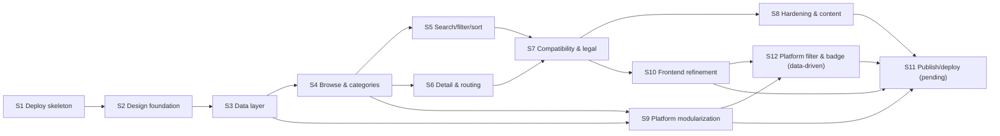

# Architecture

Status: **as-built** at `development/` (implemented, not deployed). The product is a static ES-module SPA with a modular, platform-based content library.

## 1. Runtime (as-built)

```mermaid
flowchart TD
  Browser["Browser (evergreen)"]
  HTML["index.html<br/>shell + SVG icon sprite<br/>js/main.js?v=4"]
  CSS["styles.css<br/>design tokens"]
  Main["js/main.js<br/>boot + actions + wiring"]
  Data["js/data.js<br/>fetch/validate/cache"]
  Manifest["library.json<br/>MANIFEST manifest"]
  PJson["library/platforms/&lt;id&gt;/platform.json<br/>id, name, itemFiles[]"]
  Items["library/platforms/&lt;id&gt;/items/*.json<br/>one item per file"]

  Browser --> HTML
  HTML --> CSS
  HTML --> Main
  Main --> Data
  Data -->|fetch ?v=ts, no-cache| Manifest
  Manifest -->|platforms[]| Data
  Data -->|fetch each platform| PJson
  PJson -->|itemFiles[]| Data
  Data -->|fetch each item| Items
  Main --> Router["Hash router<br/>#/ , #/category/:id , #/item/:id"]
  Main --> Store["State store (js/state.js)<br/>items, filters, firmware, route"]
  Store --> Views["Views (js/render.js):<br/>chrome, nav, topics, featured,<br/>toolbar, grid, detail, states"]
  Views --> DOM["Rendered DOM (textContent only)"]
  Data --> Cache["sessionStorage<br/>last-good assembled copy"]
```

## 2. Module responsibilities (as-built)

| Module | Responsibility |
|---|---|
| `js/main.js` | Boot, hash routing glue, actions, event wiring, URL query-param sync, header scroll/menu, `/` shortcut, `?platform=` normalization. Entry loaded as `js/main.js?v=4`. |
| `js/data.js` | Fetch the manifest; resolve `platforms[]` → each `platform.json` → its `items/*.json`; tag each item with `platformId`; validate defensively; `sessionStorage` last-good cache. Also accepts legacy flat `itemFiles` and inline `items`. |
| `js/state.js` | In-memory state + tiny event emitter. |
| `js/router.js` | Hash routing (`#/`, `#/category/:id`, `#/item/:id`). |
| `js/filters.js` | Pure functions: `matchesQuery`, `visibleItems` (status/category/**platform via `item.platformId`**/query), `isFiltering`. |
| `js/render.js` | All DOM rendering: chrome, nav, topics, featured rail, toolbar (**data-driven platform chips**), grid/cards (incl. `.badge--platform`), detail modal, skeletons, empty/no-match, error. |
| `js/a11y.js` | Live region (`announce`) + modal focus trap. |
| `js/util.js` | DOM helpers, sprite `icon`, `renderItemIcon` (word vs URL + fallback), firmware/compatibility math, `safeHttps`. |

**Rule:** renderers never insert raw JSON strings via `innerHTML`; they use `textContent`/DOM construction (NFR-S1).

## 3. Data flow (load → render)

```mermaid
sequenceDiagram
  participant U as User
  participant M as main.js
  participant D as data.js
  participant F as library.json (manifest)
  participant P as platform.json
  participant I as items/*.json
  participant S as state.js

  U->>M: open URL (?q/status/platform/sort/fw + #route)
  M->>D: loadLibrary()
  D->>F: fetch(library.json?v=ts, no-cache)
  F-->>D: manifest {site, categories, redirects, platforms[]}
  loop each platforms[i]
    D->>P: fetch(platform.json)
    P-->>D: {id, name, itemFiles[]}
    loop each itemFiles[j]
      D->>I: fetch(items/<name>.json)
      I-->>D: bare item object
    end
  end
  D->>D: attach platformId; drop invalid items; validate
  D->>D: sessionStorage.setItem(last-good)
  D-->>M: {data} | {data, cached} | {failed, error}
  M->>S: setState({library})
  M->>U: render (skeletons → grid / empty / no-match / error)
  M->>M: apply route (category/item) + syncUrl()
```

**Failure tolerance:** a failed platform or item file is skipped with a console warning; only if **all** platforms fail does the load abort (then the last-good cache + Retry is offered).

## 4. Implementation slice dependency graph (current)



## 5. Actual repository / product layout

The deployable site is `development/` (not the repo root — plan §12 U-1).

```text
/                                        (repo root: docs only)
├── DEVELOPMENT_PLAN.MD                  # planner-owned
├── development_plan/                    # planner-owned specs + schemas + examples
├── DEVELOPMENT_CURRENT_STATE.MD         # dev-stage evidence (read-only to planner)
├── mockup/                              # throwaway prototype (read-only to planner)
└── development/                         # DEPLOYABLE SITE
    ├── index.html                       # shell + inline SVG sprite; loads js/main.js?v=4
    ├── styles.css                       # tokens + components
    ├── js/                              # main, data, state, filters, render, router, a11y, util
    ├── library.json                     # MANIFEST (schemaVersion 2.0.0)
    ├── library/platforms/ps5/platform.json
    ├── library/platforms/ps5/items/*.json   # 19 items
    ├── assets/                          # banner.svg, banner.png (1600×600), favicon.svg
    ├── tools/                           # split-library.mjs, restructure-platforms.mjs
    ├── tests/                           # validate-library.mjs, inspect-dom.mjs
    ├── run_site.bat                     # one-click Windows launcher
    ├── .nojekyll
    └── README.md
```

## 6. Module cache-busting (`?v=N`)

- `index.html` loads `js/main.js?v=4`; **every** relative `import` inside `js/` carries the same `?v=4` (verified in `main.js`, `data.js`, `render.js`, `filters.js`).
- Purpose: prevent browsers/CDNs from serving a **stale module** after a data/module change. A stale `data.js` previously produced a spurious "Could not load library.json" error.
- **Rule:** when any file under `js/` changes, bump `N` in `index.html` and in every `js/*.js` relative import. (DEC-009; NFR-R2.)
- Data files use a separate runtime bust: `fetch(path + '?v=' + Date.now(), { cache: 'no-cache' })` (DEC-006).

## 7. GitHub Pages deployment (not yet done)

- The product is at `development/`; GitHub Pages "Deploy from a branch" accepts only `/` or `/docs`. This is an **open blocker** (plan §12 U-1 / DEV-1). Options: copy/move `development/` → `docs/`, or add a repo-root GitHub Actions workflow that uploads `development/` as the Pages artifact.
- `.nojekyll` is present inside `development/`.
- `library.json` and all item files are ordinary same-origin static assets (no CORS).
- When published, cache-busting must survive the host/CDN (hence `?v=N` + per-fetch `?v=ts`).

## 8. Non-goals reflected architecturally
No server, no database, no auth, no third-party requests. All state is client-side and ephemeral except `localStorage` (firmware choice) and `sessionStorage` (last-good library).
